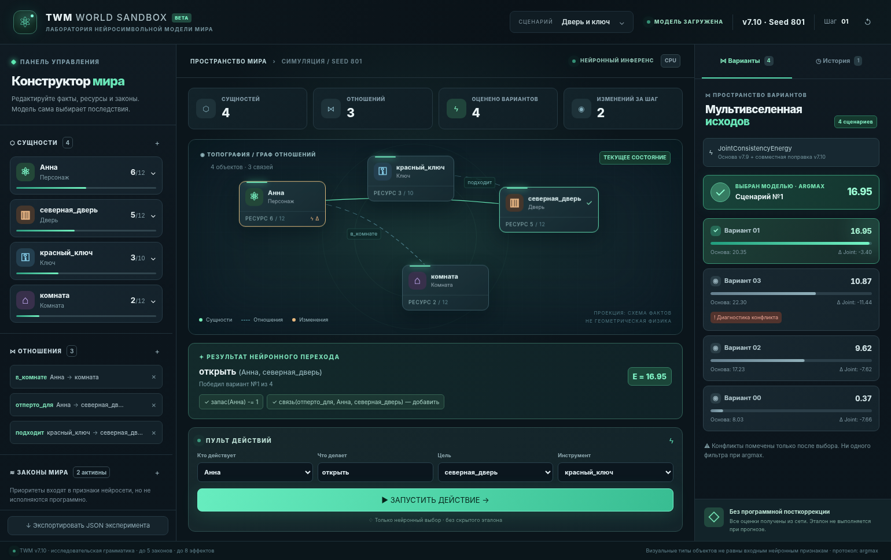

# TWM World Sandbox — интерактивная лаборатория (на русском)

**Веб-стенд с настоящей моделью TWM v7.10, Seed 801**, адаптированный под **Streamlit Community Cloud**. Это не эталонная симуляция и не имитация результата: энергии и выбор подмножества рассчитывает обученная `JointConsistencyEnergy` из исходного архива проекта.



Скриншот получен при отображении **реального ответа Seed 801**, с энергиями четырёх подмножеств, а не с подставленными данными.

## Что работает

- **Карта мира**: отдельные сущности, их ресурсы и отношения, анимированная подсветка изменений.
- **Инспектор**: добавление и удаление объектов (от 3 до 32), изменение запаса и вместимости, редактирование бинарных фактов.
- **Панель законов**: включение, отключение, приоритеты и перемещение законов, режимы эффектов (`consume`, `produce`, `transfer`), количество, изменение отношения, JSON-редактор AST условий. Одновременно 1–5 активных законов.
- **Пульт действий**: актор, глагол, цель, инструмент (все они кодируются как структурированные факты для нейросети).
- **Мультивселенная**: **все** `2^N` подмножеств с подлинными энергиями, оценкой v7.9, совместной поправкой v7.10, подсветкой победителя `argmax`, эффектами и *постфактум* диагностикой конфликтов.
- **История шагов**: сохранённые состояния и ответы, просмотр снимков, создание новой ветки из выбранного шага.
- **Три сценария** с разными *входными* фактами или законами (результаты каждого вычисляются заново моделью).
- **Адаптивный интерфейс** с анимациями для настольных и мобильных экранов; интерфейс, сообщения и документация на русском языке.

Документы-основания: [утверждённый Манифест](docs/TWM_MANIFEST_CONCEPT_v1.0_RU.md) и [технический отчёт v7.10](docs/TWM_V710_Development_Report_RU.md).

## 1. Развёртывание на Streamlit Community Cloud

1. Создайте GitHub-репозиторий и загрузите **содержимое этой папки**, включая `checkpoints_v*/`, `ui/dist/`, `.streamlit/config.toml` и `requirements.txt`.
2. Перейдите на [share.streamlit.io](https://share.streamlit.io/) и выберите **Create app → Deploy a public app from GitHub**.
3. Выберите репозиторий и ветку, укажите **главный файл `sandbox_app.py`**, в расширенных настройках выберите **Python 3.11**.
4. Запустите развертывание. На старте приложение проверяет загрузку настоящих весов Seed 801: при ошибке вы увидите явное сообщение, а не случайный или фальшивый прогноз.

**Важно:** загрузите именно содержимое папки в корень репозитория, а не архив `.zip` одним файлом. **NPM для запуска Cloud не нужен**: в `ui/dist/` уже включена автономная сборка визуального компонента без CDN и без стороннего JS-сервера.

## 2. Локальный запуск

Требуется Python **3.11**, доступ к PyTorch CPU и Streamlit.

```bash
python -m pip install -r requirements.txt
streamlit run sandbox_app.py
```

Приложение открывается по адресу `http://localhost:8501`.

## 3. Визуальная часть: две реализации

**В архиве есть оба варианта:**

- `ui/dist/twm.js`, `ui/dist/twm.css` — **готовый автономный интерактивный вариант**, без npm и сетевых библиотек. Он использует DOM, CSS-анимации и Web Animations API; функциональные панели уже работают. Именно эта версия запустится на Community Cloud сразу после загрузки файлов.
- `ui/src/index.tsx`, `ui/src/style.css` — **исходники React + Tailwind CSS + Motion for React** с более глубокими анимациями; для сборки требуется установить зависимости npm. Конфигурация Vite сохраняет JS/CSS в `ui/dist/`, откуда их затем читает Streamlit. Эти исходники синтаксически проверены, но сборка с npm **не проверена в данной среде**, потому что npm-реестр здесь недоступен. Не следует считать React-вариант подтверждённо собранным, пока не выполнен `npm run build`.

Если нужна именно React/Motion-сборка, выполните в среде, где работает npm:

```bash
cd ui
npm install
npm run check
npm run build
cd ..
```

После этого включите обновлённые файлы `ui/dist/twm.js`, `ui/dist/twm.css` в репозиторий. При запуске Streamlit автоматически начнёт использовать новую версию; менять Python-код не требуется. Исходный проект не содержит внешних API-ключей и не обращается к CDN.

## 4. Контракт данных / настоящая модель

Обёртка переиспользует **без изменения обученные веса и архитектуру** `checkpoints_v710/checkpoint_801.pt` с родительскими чекпойнтами `791 → 781 → 773 → 751`, а также архивный `write_joint`.

```
Редактор → StepRequest → структурное кодирование AST + входных фактов
→ neural proposer v7.7 → все подмножества → JointConsistencyEnergy v7.10
→ torch.argmax (без отсечений) → write_joint (без исправлений)
→ step_log + new_world_state → анимированная карта + карточки + история
```

Диагностика `invalid_numeric` / `opposed_relations` производится **после вычисления энергий** и **не влияет на выбор**. Все числовые энергии — значения сети, **не вероятности**.

**Не приписывайте текущей модели недоказанные способности.** В v7.10 нейронный энкодер **не читает** поле `kind` и произвольные `properties`. Метка «дверь» / значок замка — только проекция UI. Глаголы «открыть» и т. д. кодируются структурными фактами: сеть не получает свободноязыковую семантику автоматически. Нет оснований объявлять широкое обобщение на произвольные предметные миры или надёжную многошаговую автономность — см. исходный Манифест и отчёт.

**Реальная формула:** `total_consistency_energy = base_v79_energy + joint_v710_residual_energy`. Нельзя честно показывать раздельные *чистые* «ресурсную» и «реляционную» энергии — таких независимых аддитивных скореров в v7.10 нет.

## 5. Доступность, производительность и ограничения

- Community Cloud — CPU, до ~2.7 ГБ памяти в рамках опубликованных приблизительных ограничений; постоянная доступность не гарантируется.
- Степенной перебор: `N` предложенных эффектов → `2^N` вариантов, максимум 8 эффектов в оригинальной модели. Интерфейс показывает все, с кнопкой разворачивания при количестве более шести.
- Вся история находится **в Streamlit Session State** конкретной браузерной сессии. Это не постоянное облачное хранилище. При перезапуске приложения история не восстановится. Можно экспортировать JSON текущего ввода.
- Нейронный прогноз может вернуть некорректные запасы. Они отображаются без исправления; новый запрос с невалидным начальным запасом отклоняется до инференса. Можно вернуться к более раннему снимку.
- Локальная установка PyTorch CPU может отличаться от устройства к устройству; для Cloud рекомендуется Python 3.11.

## 6. Проверки

```bash
python -m pytest -q tests/
python -m py_compile sandbox_app.py
node --check ui/dist/twm.js
```

Реальные контрольные прогоны трёх примеров с Seed 801 успешно завершены и подтвердили `argmax`, отображение всех масок, ветвление и сброс. Автономный интерфейс проверен в Chromium на размерах 1540×970 и 390×844 без ошибок JavaScript и горизонтального переполнения. Полную интеграцию непосредственно в Streamlit Cloud можно проверить только после развёртывания.

## Структура

```
sandbox_app.py            Python-координатор Streamlit, кеш загрузки Seed 801
sandbox_backend/          исходный Step 1: схемы + адаптер + честный run_step
ui/dist/                 готовый автономный компонент (для Cloud npm не нужен)
ui/src/                  исходники React / Motion / Tailwind
ui/package.json          зависимости и команды React-сборки
checkpoints_v*/          оригинальная цепочка обученных весов
.streamlit/               (фактически .streamlit/config.toml) стили сервера
example_step.json         исполняемый пример
LICENSE                   лицензия исходного архива
```

Проект следует утверждённому `TWM_MANIFEST_CONCEPT_v1.0_RU`: фронтенд может быть зрелищным, но не должен подменять обучаемую модель программным исполнителем.
